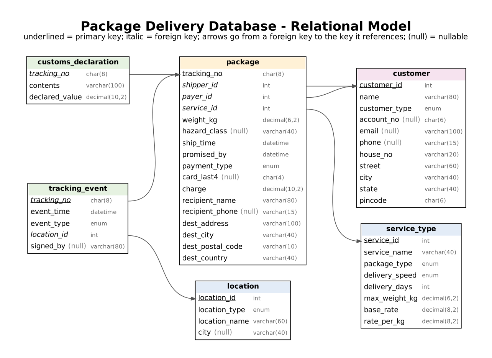

# Package Delivery Database: Relational Model

**Bold** = primary key, *italic* = foreign key (→ the table it references).

| Table | Columns |
|---|---|
| customer | (**customer_id**, name, customer_type, account_no, email, phone, house_no, street, city, state, pincode) |
| service_type | (**service_id**, service_name, package_type, delivery_speed, delivery_days, max_weight_kg, base_rate, rate_per_kg) |
| location | (**location_id**, location_type, location_name, city) |
| package | (**tracking_no**, *shipper_id* → customer, *payer_id* → customer, *service_id* → service_type, weight_kg, hazard_class, ship_time, promised_by, payment_type, card_last4, charge, recipient_name, recipient_phone, dest_address, dest_city, dest_postal_code, dest_country) |
| customs_declaration | (***tracking_no*** → package, contents, declared_value) |
| tracking_event | (***tracking_no*** → package, **event_time**, event_type, *location_id* → location, signed_by) |

## From the E-R diagram to tables

* **Strong entity sets** become tables: customer, service_type, location and package.
* **Many-to-one relationships** become a foreign key in package:
  * ships → package.shipper_id
  * pays_for → package.payer_id
  * uses → package.service_id
  * scanned_at → tracking_event.location_id
* **Weak entity sets** become tables whose key includes the owner's key:
  * **tracking_event** is keyed by (tracking_no, event_time). event_time is its discriminator.
  * **customs_declaration** is keyed by tracking_no alone, since a package has at most one
    declaration.
* **Composite attributes** (address, recipient, destination) are split into their parts.
* The kinds of location (warehouse, truck, plane) and of customer (contract, occasional) are
  stored as a type column. This is simpler than a separate table for each kind, because they
  have almost the same attributes.

## Normalization

In every table, each non-key column depends on the whole primary key and nothing else.
service_name, location_name, account_no and email are also candidate keys. So **every table
is in BCNF**, and therefore also in 3NF.

Points that might look like redundancy, and why they are not:

* **package.charge is stored.** It is computed from the service rates and the weight when the
  package is shipped. Rates change over time, so the charge billed is a fact about that package
  and cannot be recomputed later.
* **package.promised_by is stored** for the same reason. It is the delivery commitment made at
  shipping time.
* **No "delivered" or "current location" column in package.** Both can be derived from
  tracking_event (the 'Delivered' event, and the latest event). Storing them would duplicate
  data and could disagree with the history.
* **The recipient's address is stored in package.** The recipient is often not a customer, and
  each package has its own destination.
* **Customer addresses are not split by pincode.** In practice pincode → city, state. The address
  columns are still kept together because addresses are entered as a unit.

## Constraints

* **PRIMARY KEY** on every table. **FOREIGN KEY** for every relationship (6 FK columns). A
  package's customs declaration and tracking events are deleted with it (ON DELETE CASCADE).
* **UNIQUE:** account_no, customer email, service_name, location_name.
* **CHECK constraints:**
  * A Contract customer has an account number; an Occasional customer does not.
  * The pincode is 6 digits.
  * Weight, rates, charge and declared value are positive. promised_by is after ship_time.
* **Payment rules (CHECK):**

  | payment_type | card_last4 | payer |
  |---|---|---|
  | Credit Card | must be given | the shipper |
  | Account | not given | the shipper |
  | Prepaid | not given | a different customer (e.g. the shop paying for a return) |

* **signed_by** is filled in only for a 'Delivered' event (CHECK).

### Rules not enforced by the database

These rules involve two tables, which a MySQL CHECK cannot do. They would need triggers, so
they are kept by careful data entry:

* An Account or Prepaid payer must be a Contract customer.
* A package's weight must not exceed its service's max_weight_kg.
* International packages must have a customs declaration.
* 'Picked Up' and 'Out for Delivery' events must happen at a truck.

## Indexes

| Index | Used by |
|---|---|
| tracking_event(location_id, event_time) | what was on truck 1721 / in a warehouse at a given time |
| tracking_event(event_type, event_time) | finding deliveries (last delivery, late packages) |
| package(payer_id, ship_time) | monthly bills, top spender |
| package(shipper_id, ship_time) | top shipper in the past year |
| customer(street, city) | street with the most customers |
